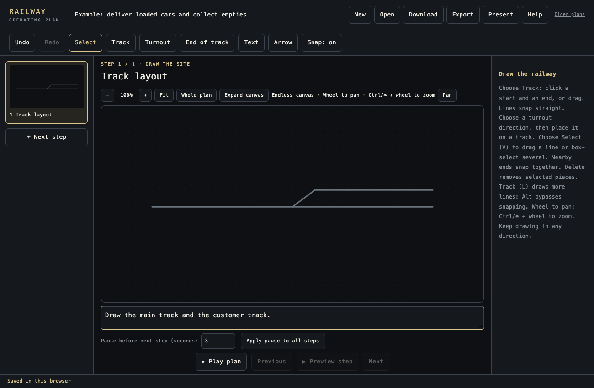
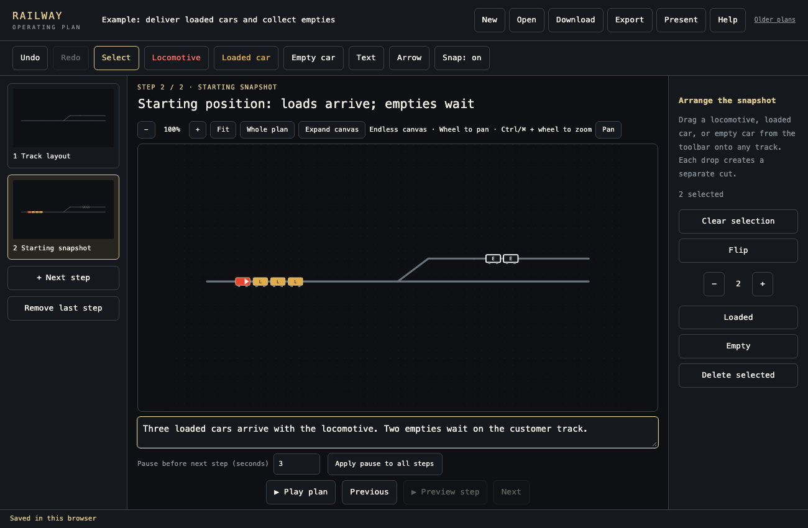
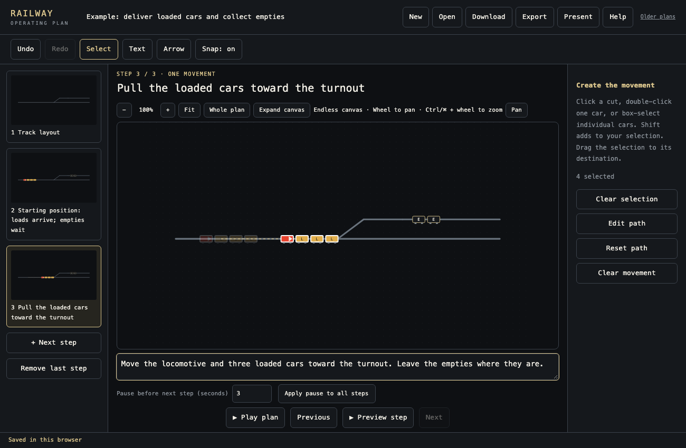
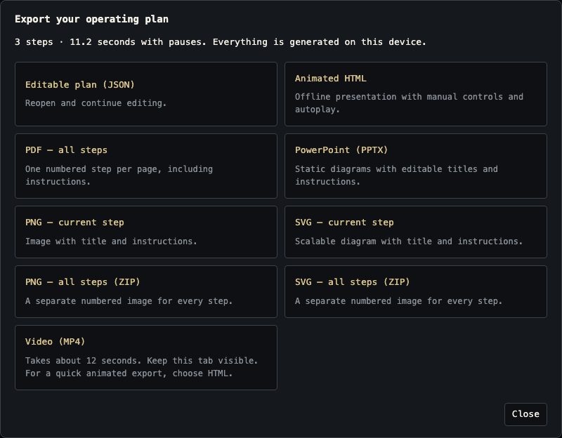

# Railway Operating Plan Creator

**A free, simple tool for drawing and sharing railway operating plans.**

Created by **Orgo Nag**.

Explaining a railway move with words alone can be difficult. A single drawing shows where the cars are, but not how they get from one track to another. Redrawing the same yard for every move takes time.

This tool lets you draw the yard once, place the locomotive and cars, then show the work one animated step at a time—like making a slide presentation.

**[Open the free editor →](https://orgonag.github.io/railway-operating-plan-creator/)**

Runs in your browser. No account or installation needed.

## What can you make?

A plan that shows **where the train starts, which cars move, where they go, and what happens next**. Add short instructions, arrows and labels, then play it or export it.

For example: a train arrives with three loaded cars. Two empty cars are waiting on a customer track. Your plan shows how the loads are delivered and the empties collected.

You decide the movements, routes and scale. The tool helps you draw and explain the plan; it does not decide how to operate the railway.

## Visual-use disclaimer

This is a visual drawing and communication tool only. It does not provide engineering advice, certify a design, or calculate or confirm track capacity, clearances, equipment fit, or safe operating conditions. Drawings and animations are illustrative and may not be to scale. They do not replace qualified engineering review, railway operating rules, or site-specific safety procedures. Users are responsible for verifying their plans before putting them into practice.

## Make your first plan

### 1. Draw the tracks

Choose **Track**. Click where a line starts, then click where it ends—or drag between the two points. Keep **Snap: on** to draw straight lines and join nearby ends.

Choose **Turnout** to add a track connection. Pick one of the four direction pictures, then place it on the drawing. Add **Text** for track names and **End of track** markers where needed.

To change something, choose **Select**, click it and drag it. Drag a box to select several pieces. Press **Delete** to remove them, or **Undo** to bring them back.

When the layout is ready, click **+ Next step**. The same tracks are used throughout the plan.

### 2. Show the starting position

Drag **Locomotive**, **Loaded car** and **Empty car** from the toolbar onto the tracks. Place equipment on as many tracks as you need.

Click a group of cars and use **+ / −** to change how many it contains. Use **Flip** to change which way equipment faces. Gold cars marked **L** are loaded; dark cars marked **E** are empty.

This step is the starting picture—not a movement. Click **+ Next step** when everything is in place.

### 3. Show one move per step

Select the locomotive and cars that should move, then **drag them to their destination**. The app suggests a path. Click **Preview step** to watch it.

- **Click a car:** select its group, also called a cut.
- **Double-click a car:** select just that car.
- **Drag a box:** select only the cars inside it.
- **Hold Shift:** add more equipment to your selection, such as the locomotive.

Give the step a short title and write what the crew should do. Add arrows or labels if they help. If the suggested route is wrong, use **Edit path** to adjust it.

**One step = one movement. If the train reverses, start a new step.** Keep clicking **+ Next step** until the work is explained.

### 4. Play it, save it and share it

Set **Pause before next step** to give viewers time to read each instruction. Click **Play plan** to watch the whole sequence, or **Present** to move through it yourself.

**Download** saves an editable plan file. Keep this as your backup; use **Open** to continue editing it later. The browser also saves your work automatically, but a downloaded file lets you keep separate plans or move to another computer.

Choose **Export** when you are ready to share:

| You want to… | Choose… |
| --- | --- |
| Share an animation that opens in a browser | **Animated HTML** |
| Share a video | **Video** — MP4 where supported, otherwise WebM |
| Print the steps or send them for review | **PDF** |
| Put the plan into a presentation | **PowerPoint** — still diagrams with editable titles and instructions |
| Use individual diagrams in another document | **PNG** or **SVG** |

Video takes the plan's playback time to record. Keep the tab visible while it runs. Animated HTML is the quick option when you want to share movement.

## A few useful tips

- **Need more room?** Scroll to move around the drawing. Use the zoom buttons or Ctrl/⌘ + scroll to zoom. There are no fixed canvas edges. **Fit** brings the current step back into view.
- **Made a mistake?** Use **Undo**. To correct an earlier step, choose **Revise this step**. Then use **Rebuild remaining steps** to update the later movements together. It keeps destinations and notes, but suggests paths again—preview the result.
- **Want a reminder?** Click **Help** for the short guided tour.
- **Need more detail?** Read the [full user guide](docs/user-guide.md), including path editing, saving, recovery and keyboard controls.

## Questions, bugs or ideas?

[Open a GitHub issue](https://github.com/orgonag/railway-operating-plan-creator/issues) or contact **Orgo Nag on LinkedIn**. Feedback and suggestions are welcome.

For a bug report, include what you were trying to do, what happened, and a screenshot if possible. This makes it easier to reproduce and fix the problem.

## For contributors

The app is open source under the [Apache 2.0 licence](LICENSE). Example plans and screenshots use a made-up yard.

For local setup, tests and project structure, see [Development](docs/user-guide.md#development), [AGENTS.md](AGENTS.md) and the [slide-authoring maintenance guide](docs/skills/slide-authoring/SKILL.md).
